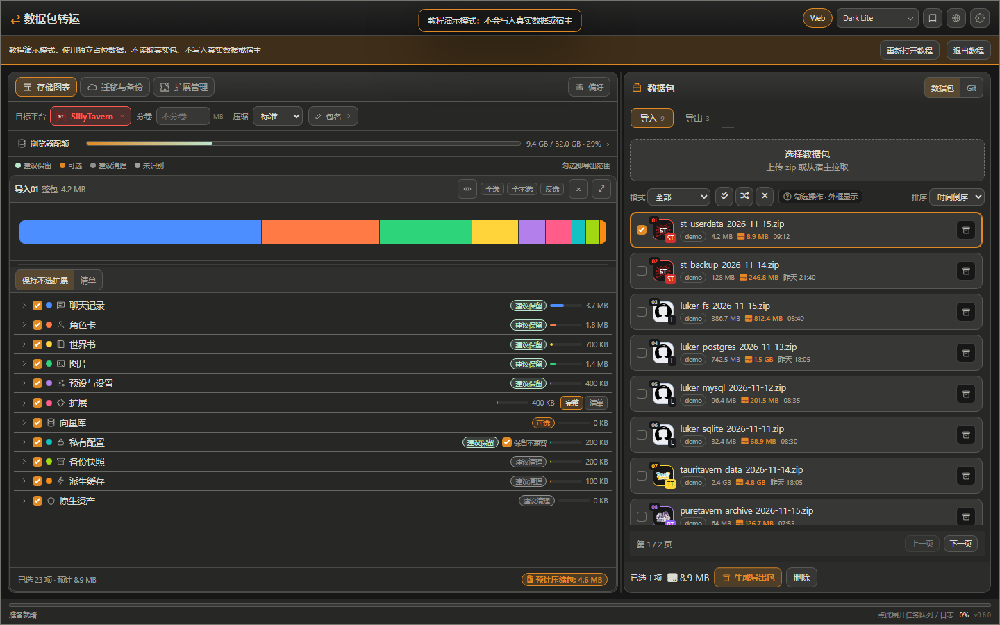
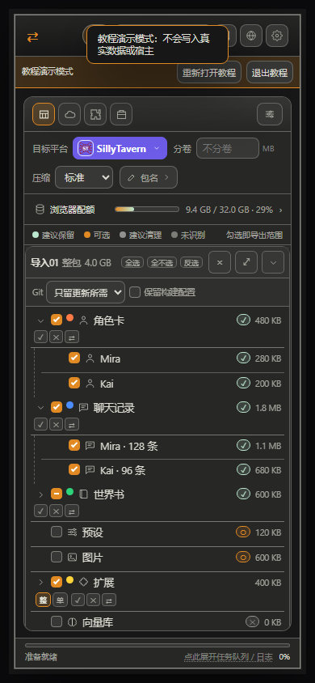
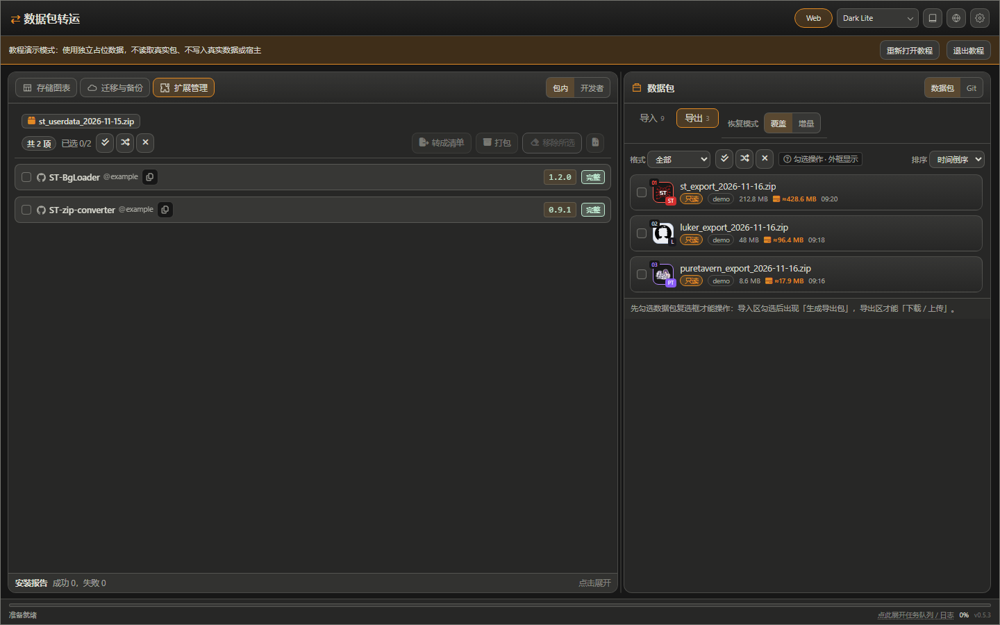
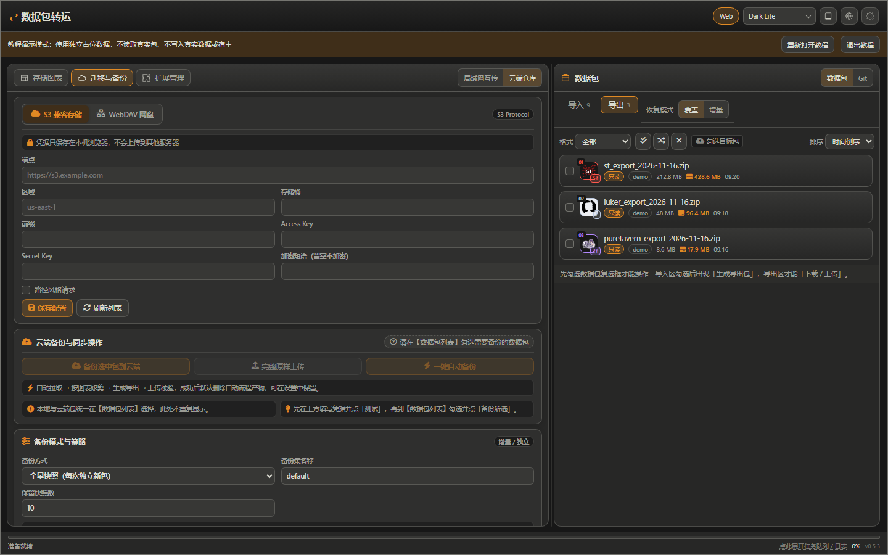

# ST-pack-transfer

Move, convert, back up and restore data packs between **SillyTavern / Luker / TauriTavern / PureTavern**.

Pure front end: inside a tavern it is a feature panel, and it also runs as a standalone web page with no backend of its own.

[Online](https://jiozhaoyue.github.io/ST-pack-transfer/) · [Documentation](https://jiozhaoyue.github.io/ST-pack-transfer/docs/) · [GitHub](https://github.com/jiozhaoyue/ST-pack-transfer/)

## Screenshots

| Desktop workbench | Mobile |
| :---: | :---: |
|  |  |

| Extension manager | Transfer and backup |
| :---: | :---: |
|  |  |

All screenshots come from the tutorial demo mode and contain no real data.

## Core features

- **Four-way conversion**: SillyTavern, Luker, TauriTavern and PureTavern in any direction
- **Private file preservation**: host-specific config is sealed into a sandbox on the target and unpacked on the way back
- **Git policy**: per extension, keep full history or manifest only; chart volume accounts for stripped content
- **Luker engine conversion**: filesystem, PostgreSQL, MySQL and SQLite
- **One-click auto backup**: manual trigger; automatically pulls from the host, converts and uploads to the cloud, then prunes old snapshots to the retention you set
- **LAN transfer**: peer connections (pairing code / QR scan, persistent connection, bidirectional task queues) with a single-shot fallback mode
- **Cloud channel**: S3 / WebDAV upload, listing and snapshot restore; credentials persist, nothing lost on reload
- **Tutorial demo mode**: standalone placeholder data, zero real writes; "Skip" exits the demo and restores real data
- **Storage inspector**: usage by category, drill down level by level
- **Pending export area**: every artifact lands in a queue, nothing downloads automatically; save into the workspace with filename-template preview
- **Panel help**: every panel header carries a `?` help entry that opens the usage of the current view
- **Sanitized share and upload guard**: one-click sanitized share pack (character cards physically removed, chats kept, `settings.json` cleaned via an AST whitelist); before any server upload a content-level local hard guard scans the actual ZIP entries and text — a character card or plaintext credential blocks the upload, with no external marker files
- **Dual-channel upstream tracing**: naturally covers fork derivatives and this repo's changelog, and dynamically traces the original official upstream (jiozhaoyue) through the GitHub API source chain, falling back to the built-in default repo on parse failure — no Git history walking; dual-track issue submission and direct doc links
- **Issue reports**: one-click, sanitized environment reports you can copy to the clipboard or export as local Markdown — with key-level redaction that folds token/secret/password values; no repository URL to fill in, platform and account picked from dropdowns; attached logs are level- and count-selectable with a safe-minimum default and a clear notice of what is collected; over-long content or a URL past the 8000-character guard falls back to copy; preview toggles between raw and rendered views; form fields follow the GitHub issue template; two required checkboxes must be confirmed before submitting; one-click links to issue lists and docs for both this repo and the upstream
- **Restore format validation**: before restoring, each pack's format is checked against the current host; incompatible packs prompt to convert first; split packs are handled as a whole group — one pack or one split group at a time

## Features that need the network

Pure conversion, analysis, splitting, manifesting and LAN transfer (peer-to-peer) all work offline, with no network needed.

- **Automatic network access by default**: opening the issue-report panel calls the GitHub API to trace upstream coordinates and fetch issue templates (only when missing locally); failures degrade silently without affecting the main UI.
- **User-triggered only**: checking updates, per-extension auto update (rules required first), cloud commit log, issue submission, tutorial sample list sync, S3 / WebDAV cloud repos and OAuth authorization — each needs a manual action or configured credentials.

The full list with endpoints, triggers and fallback behavior: [network functions list](test-results/network-functions-list.md).

## Installation

### Into a tavern

In the tavern's extension manager, choose install from URL and paste:

```text
https://github.com/jiozhaoyue/ST-pack-transfer.git
```

Or clone into `public/scripts/extensions/third-party/`, reload the page, expand the data pack transfer extension in the extension list and open the panel.

### Single-file web page

Download [ST-pack-transfer-offline.html from GitHub Release](https://github.com/jiozhaoyue/ST-pack-transfer/releases/latest/download/ST-pack-transfer-offline.html) and open it directly. No Node and no local server required. The file is distributed via Release and is not tracked in the repository.

The `index.html` at the repository root is a development skeleton and cannot be opened on its own.

### Local development

```bash
git clone https://github.com/jiozhaoyue/ST-pack-transfer.git
cd ST-pack-transfer
npm install
npm run dev            # dev server, fixed at http://localhost:3040
npm run build          # outputs dist/
npm run build:offline  # outputs the single-file HTML
npm test               # unit tests
```

The local port is configured in one place: `LOCAL_PORT` in `vite.config.js` (default 3040), or the `PORT` environment variable before starting.

## Supported hosts

| Host | Layout code | Notes |
| --- | --- | --- |
| SillyTavern | `st` | The backup endpoint has no per-user selection; the plugin filters |
| Luker | `l` | Selection-capable backup; multiple storage engines |
| TauriTavern | `tt` | Uses the Tauri-side data layout |
| PureTavern | `pt` | Modular record structure |

## Privacy and credentials

The plugin has no server of its own and never sends credentials to third parties.

By default stored only in this browser's localStorage; can be switched to server `settings.json` in Settings.

Credentials are only needed for external services; every other feature works without them.

## Development and quality

```bash
npm test                    # unit tests
npm run verify:rules        # rule verification
npm run check:css-scope     # CSS scope guard
npm run check:dom-injection # DOM injection guard
npm run check:i18n          # hardcoded-copy guard
npm run docs:verify         # documentation sync check
```

Architecture and change guidance: [docs/DEVELOPER-GUIDE.md](docs/DEVELOPER-GUIDE.md).

## Documentation

- [Documentation site](https://jiozhaoyue.github.io/ST-pack-transfer/docs/)
- [Developer guide](docs/DEVELOPER-GUIDE.md)
- [FAQ](docs/faq.md)
- [中文 README](README.md)

## License

[AGPL-3.0-or-later](LICENSE)
