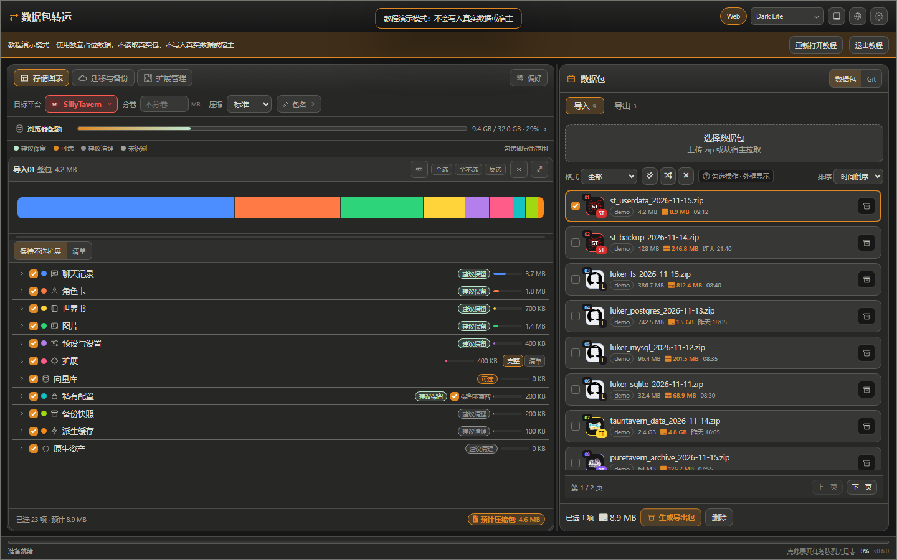
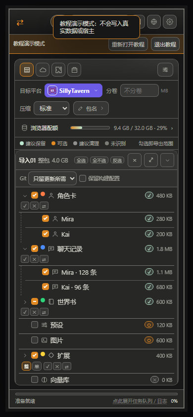
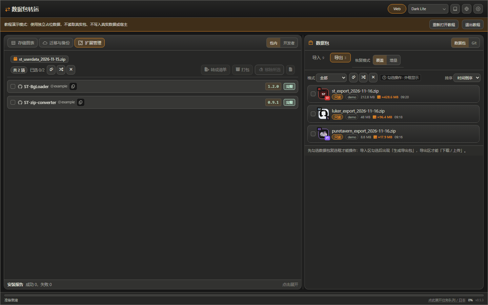
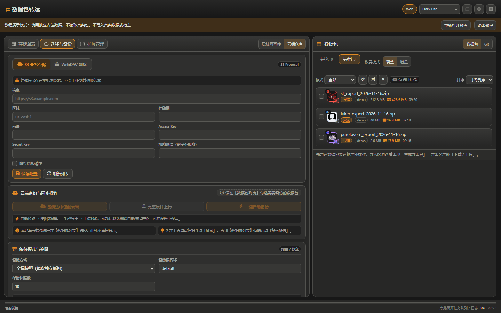

# ST-pack-transfer · 数据包转运

在 **SillyTavern / Luker / TauriTavern / PureTavern** 四款酒馆之间迁移、转换、备份与恢复数据包的工具。

纯前端实现：装进酒馆是一个功能面板，也可以直接作为独立网页使用，无需自建后端。

[在线使用](https://jiozhaoyue.github.io/ST-pack-transfer/) · [完整文档](https://jiozhaoyue.github.io/ST-pack-transfer/docs/) · [GitHub 仓库](https://github.com/jiozhaoyue/ST-pack-transfer/)

## 界面

| 桌面工作台 | 移动端 |
| :---: | :---: |
|  |  |

| 扩展管理 | 迁移与备份 |
| :---: | :---: |
|  |  |

截图全部来自教程演示模式，不含真实数据。

## 核心功能

- **四端互转**：SillyTavern、Luker、TauriTavern、PureTavern 任意双向转换
- **私有件留存**：各端专属配置封箱到目标端沙盒，逆向转换时还原
- **Git 策略**：每扩展可选完整或清单模式，图表按策略扣除将被剔除的体积
- **Luker 引擎互转**：文件系统、PostgreSQL、MySQL、SQLite 之间转换
- **自动备份**：定时拉取与快照，按用户设定的份数裁剪
- **局域网互传**：对等长连接（生成互联码 / 扫码直连，保持连接不重连，双向任务队列交替调度）与传统单次模式（降级）
- **云端通道**：S3 / WebDAV 上传、列表与快照恢复；凭据持久保存，刷新不丢
- **教程演示态**：独立占位数据，零真实写入；「跳过」即退出演示态并还原真实数据
- **存储审查**：按分类查看占用，可逐层下钻
- **待导出区**：所有产物先进队列，不自动下载

## 安装

### 装进酒馆

在酒馆「扩展管理」→「从 URL 安装」粘贴：

```text
https://github.com/jiozhaoyue/ST-pack-transfer.git
```

或克隆到 `public/scripts/extensions/third-party/`，刷新页面后在扩展列表展开「数据包转运」，点「打开面板」。

### 单文件网页

从 [GitHub Release 下载 ST-pack-transfer-offline.html](https://github.com/jiozhaoyue/ST-pack-transfer/releases/latest/download/ST-pack-transfer-offline.html) 双击即可运行，不需要 Node 与本地服务器。该文件由 Release 分发，不入库。

根目录的 `index.html` 是开发骨架，不能单独双击使用。

### 本地开发

```bash
git clone https://github.com/jiozhaoyue/ST-pack-transfer.git
cd ST-pack-transfer
npm install
npm run dev            # 开发服务器，固定 http://localhost:3040
npm run build          # 产出 dist/
npm run build:offline  # 产出单文件 HTML
npm test               # 单元测试
```

本地端口只有一处可改：`vite.config.js` 的 `LOCAL_PORT`（默认 3040），或启动前设置环境变量 `PORT`。

## 支持的宿主

| 宿主 | 布局码 | 说明 |
| --- | --- | --- |
| SillyTavern | `st` | 备份端点不支持按用户选择，插件侧过滤 |
| Luker | `l` | 支持选择式备份；多种存储引擎 |
| TauriTavern | `tt` | 使用 Tauri 侧数据布局 |
| PureTavern | `pt` | 模块化记录结构 |

## 隐私与凭据

插件没有自有服务器，凭据不会发给第三方。

默认存服务端 `settings.json`，有权限的用户可见；可改为仅存浏览器本机，清缓存即丢失。

凭据只在连接外部服务时需要，其余功能都不依赖它。

## 开发与质量

```bash
npm test                    # 单元测试
npm run verify:rules        # 规则校验
npm run check:css-scope     # CSS 作用域守卫
npm run check:dom-injection # DOM 注入守卫
npm run check:i18n          # 硬编码文案守卫
npm run docs:verify         # 文档同步校验
```

架构与改动指引见 [docs/DEVELOPER-GUIDE.md](docs/DEVELOPER-GUIDE.md)。

## 文档

- [完整文档站](https://jiozhaoyue.github.io/ST-pack-transfer/docs/)
- [开发者指南](docs/DEVELOPER-GUIDE.md)
- [常见问题](docs/faq.md)
- [English README](README.en.md)

## 许可

[AGPL-3.0-or-later](LICENSE)
