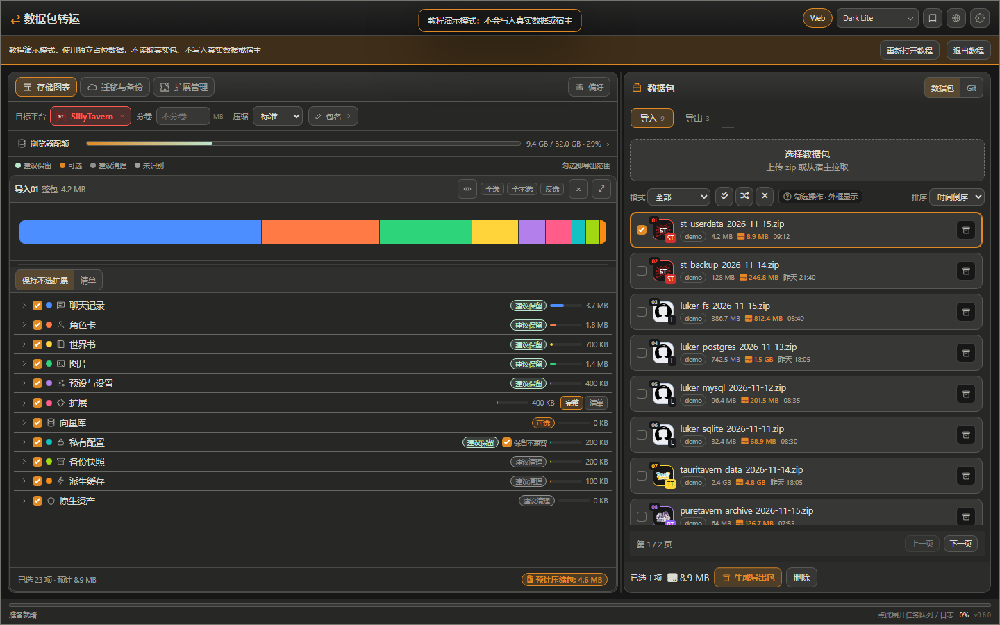
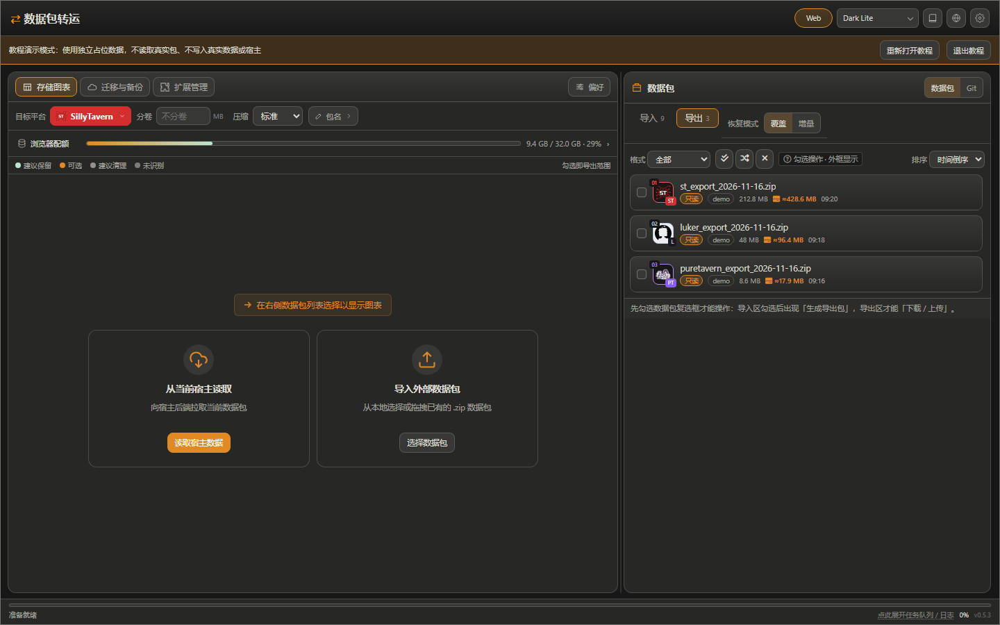
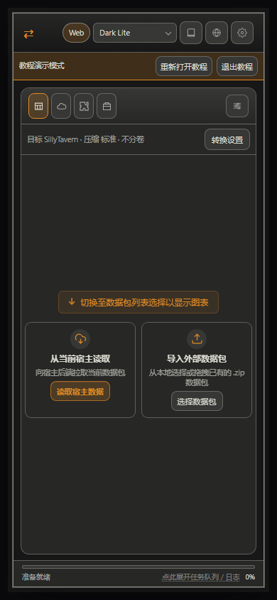

# Data pack conversion

Convert data packs between SillyTavern, Luker, TauriTavern, and PureTavern—whether you are moving to another tavern or organizing backups.

## Basic steps

1. **Choose the target platform**: the **Target platform** menu defaults to **Match source** — the selected package's source platform, or the current host when no package is selected. Pick an entry to override it; your explicit choice is then remembered.
2. **Select what to bring**: use the **Storage chart** on the left to tick the items you want.
3. **Choose source packages**: tick the packages to convert in the **Package list** on the right.
4. **Generate**: click **Generate export package** at the bottom.
5. **Collect and save**: switch to the **Export area** to download, keep in the workspace, or remove the result.

<figure class="shot-figure">
  
  <figcaption>Workbench: pick content on the left, packages on the right</figcaption>
</figure>

> Note: the **Generate export package** button becomes available after at least one package is selected.

## Selectable categories

You can choose any of the following:

Chats, character cards, world books, image assets, presets, extensions, vector databases, user settings, backup archives, cache files, and built-in tavern assets.

The chart shows a suggestion badge for each category (keep, optional, clean up) so you can expand and confirm.

## Pre-conversion analysis

Before generating, the tool inspects the package and shows:

- **Automatic cleanup**: target-specific caches or temporary files the target tavern does not need;
- **Path adaptation**: files that will be reorganized or renamed for the target layout;
- **Warnings**: special settings worth checking after import.

The analysis can be downloaded as a report.

## Merge and update (delta mode)

Pick **Incremental** in **Restore mode** on the right of the **Package** tab, then click **Generate export package** to produce a `.delta.zip` **incremental patch package** instead of a full package. This is wired into the conversion main chain — both single-package generation and multi-package merging support it (incremental is not combined with splitting).

- **Patch contents**: the `_delta_manifest.json` inside records `generator` (`ST-pack-transfer`), `type` (`delta-patch`), `baseArchiveName` (the baseline package name), plus `stats` (`addedCount` / `modifiedCount` / `deletedCount`, etc.) and `changes` (entries grouped into `added` / `modified` / `deleted`).
- **Baseline package**: the most recent **full** conversion output of the same target layout is used as the baseline (the patch itself is excluded). The core layer's `compareArchives` / `generateDeltaArchive` (`src/core/delta.js`) compares entry by entry and writes only added and modified entries into the patch, recording deletions as well.
- **No baseline fallback**: if no full output exists for the target, incremental export **falls back to a full package** with the message "No baseline package for this target; incremental export fell back to a full package" — it never silently produces an empty patch.
- **Storage marking**: patch outputs are auto-labeled with the "Incremental patch" origin (`ORIGINS.DELTA`) and shown as **Incremental patch** in the export area, easy to tell apart from ordinary full packages. The conversion report also includes added / modified / deleted counts and the patch size.
- **Restore**: an incremental patch must be merged with its baseline on the restore side — see "Incremental patch restore (automatic merge on Luker)" in [Restore to host](restore.en.md).

## Smart split packages

If your cloud tavern limits upload size, set a split size in the settings (MB, 32–2048). The output is split into independently importable parts. Leave it empty to disable splitting.

Each part contains a `_convert/split-manifest.json` manifest recording that part's target layout (`target`, one of st / l / tt / pt), part index and total. Layout detection uses `target` first, so split parts are recognized without renaming. Older parts without `target` fall back to filename and other heuristics; a package whose layout cannot be confirmed is rejected on restore with a prompt to convert it to the current host format first.

## Resume and task control

- You can **pause, continue, or cancel** at any time.
- Pausing saves the files already written; continuing checks the existing progress and resumes without producing an incomplete package.
- If browser storage is tight, the tool falls back to a full regeneration and explains it in the log.

## Export area

Generated packages are collected in the **Export area** instead of downloading automatically. Download or move them to the local workspace whenever you are ready.

<figure class="shot-figure">
  
  <figcaption>Desktop export area: download, save, or remove generated packages</figcaption>
</figure>

<figure class="shot-figure">
  
  <figcaption>Mobile export area: the same responsive layout</figcaption>
</figure>

## Related reading

- Format details: [Data pack formats of four taverns](formats.en.md)
- If the target is Luker, see [Storage engine conversion](engines.en.md)
