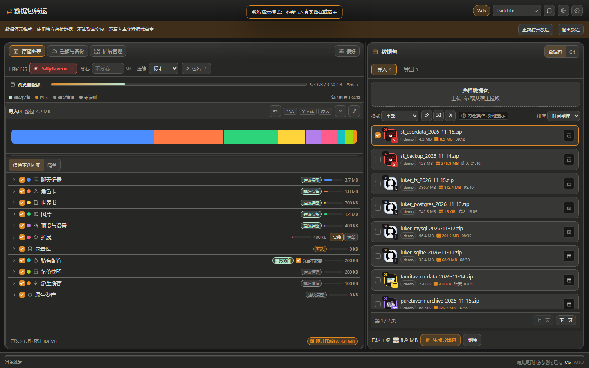
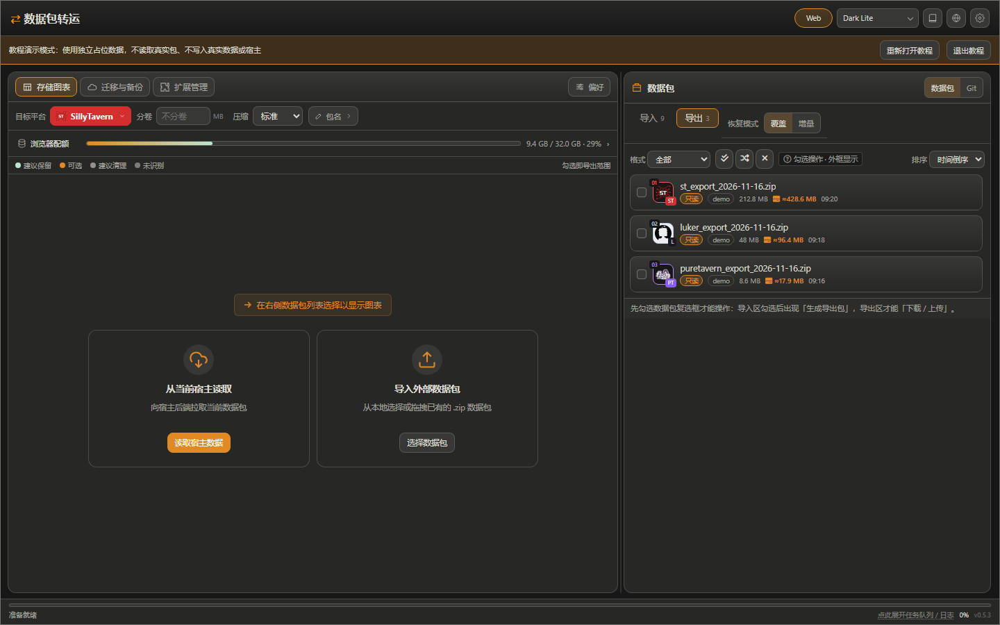
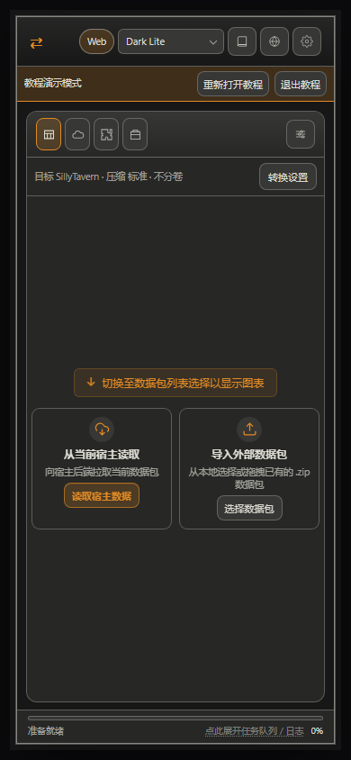

# 数据包转换

在 SillyTavern、Luker、TauriTavern、PureTavern 四款酒馆之间互相转换数据包，不管是跨平台搬家还是备份整理，都能轻松搞定。

## 基本操作步骤

1. **选择目标平台**：顶部「目标平台」默认为**跟随来源** —— 选中数据包时按该包的来源平台，未选包时按当前宿主。需要覆盖时在下拉菜单里显式选一项，之后会持续记住你的选择。
2. **挑选需要的内容**：在左侧「存储图表」中按需勾选你想带走的项目。
3. **选定源数据包**：在右侧「数据包列表」中勾选要转换的数据包。
4. **开始生成**：点击底部的「生成导出包」按钮开始转换。
5. **取件与保存**：完成后切到「导出区」，即可自由下载到本地、存入工作区或随手移除。

<figure class="shot-figure">
  
  <figcaption>工作台：左侧挑选内容，右侧勾选数据包</figcaption>
</figure>

> 提示：勾选了至少一个待转换的数据包之后，底部的「生成导出包」按钮就会亮起。

## 支持自由挑选的类目

你可以按需挑选以下内容：
聊天记录、角色卡、世界书、图片素材、配置预设、扩展插件、向量数据库、个人配置、备份存档、缓存文件与酒馆内置资源。

图表中为每个类目提供了贴心的建议标签（如建议保留、可选、建议清理），方便你按需展开确认。

## 转换前智能分析

在点击生成前，工具会自动对数据包进行完整体检，并清晰展示分析结果：

- **自动清理项**：目标酒馆不需要的专属缓存或临时文件；
- **路径适配项**：自动按照目标酒馆的目录规范进行重组或重命名的文件；
- **关注提醒项**：建议你在导入后稍加留意的特殊配置。

这份分析结果支持一键下载为报告，方便你对照参考。

## 合并与更新（差量模式）

> 如实说明当前进度：差量能力目前只到核心层结构，**尚未接入转换主链路与界面**。

- 核心层已有 `compareArchives` / `generateDeltaArchive`（`src/core/delta.js`），可产出增量补丁包结构：包内 `_delta_manifest.json` 记录 `generator` / `type`（delta-patch）/ `baseArchiveName` / `stats` / `changes` 字段；
- 该生成函数当前**仅有测试引用**（`test/delta.test.js`），转换主链路（`index.js` 的 `generate` / `generateMerged`）未接入差量分支，界面的差量切换不会产生差量包；
- 补丁包的合并 / 应用函数未接线（`src/ui/host-bridge.js` 的 `incrementalMergeArchives()` 标注「未接线：当前无任何调用方」），「冲突自动处理并记录报告」**不存在**；
- 待增量恢复功能落地后，本节会更新为可用的操作说明。

## 智能分卷包

如果你使用的云端酒馆对单次上传的数据包大小有限制，可以在设置中填写分卷大小（单位为 MB，支持 32–2048 MB）。生成时会自动拆分成多个可以独立导入的分卷小包；如果不需要拆分，留空即可。

每个分卷包内含 `_convert/split-manifest.json` 清单，记录该分卷的目标布局（`target`，取值 st / l / tt / pt）、分卷编号与总数等信息。识别包布局时以 `target` 为准，因此分卷包无需改名即可被正确识别；旧包无 `target` 时会回退按文件名等特征判断，无法确认布局的包会被拒绝回传，提示先转成当前宿主格式。

## 断点续传与任务控制

- 打包过程中你可以随时**暂停、继续或取消**。
- 暂停时会自动妥善保存当前已写入的文件；点击继续后，会自动检查已有进度并无缝接续，确保最终生成的数据包完整可用。
- 如果浏览器本地存储空间吃紧，系统会自动平稳切换为全量重新生成，并在日志中给出清晰说明。

## 导出区管理

所有生成好的数据包都会整齐收纳在下方的「导出区」列表中，不会直接自动弹出下载打扰你。你可以按自己的节奏，随时点击下载或保存到本地工作区中。

<figure class="shot-figure">
  
  <figcaption>桌面端导出区：下载、保存或移除生成的数据包</figcaption>
</figure>

<figure class="shot-figure">
  
  <figcaption>手机端导出区：同一套响应式布局</figcaption>
</figure>

## 相关阅读

- 各酒馆的格式细节请参考 [四酒馆数据包格式](formats.md)
- 如果目标酒馆是 Luker，还可以体验数据库互转功能，详见 [存储引擎互转](engines.md)
