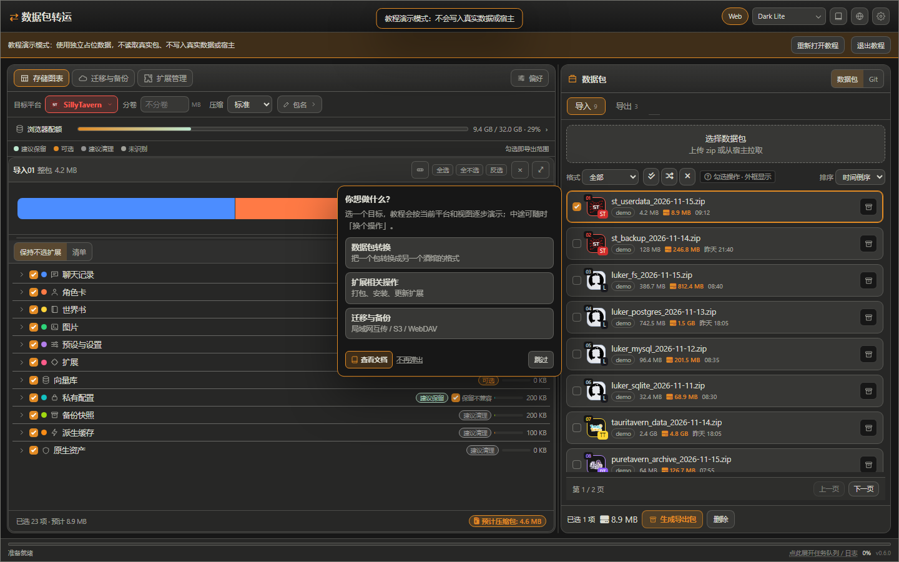
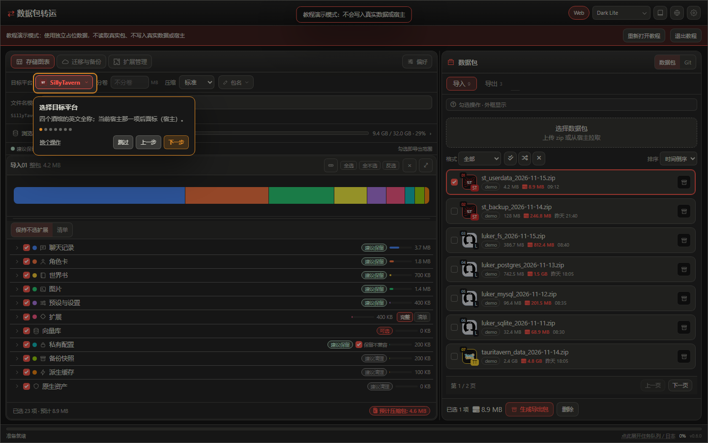

# Installation & deployment

## Interface preview

On first launch, the tutorial walks you through the interface on simulated data:

<figure class="shot-figure">
  
  <figcaption>Goal picker: choose the feature to practice</figcaption>
</figure>

<figure class="shot-figure">
  
  <figcaption>Step guidance: the current action is highlighted</figcaption>
</figure>

## 1. Choose a runtime form first

| Form | How to use it | Best for | Host / browser requirement |
| --- | --- | --- | --- |
| Tavern extension | Install from the repository URL in the extension manager | Pull, restore, and manage extensions inside a tavern | See “Host versions” below |
| Online Web | Open the online URL | Local conversion, analysis, splitting | Modern desktop or mobile browser |
| Single-file HTML | Download and double-click | Offline, no network, portable | Modern desktop browser; runs over `file://` |
| Local static server | Build and open over HTTP | Self-hosting, LAN sharing | Any modern browser |

### Exact download path for the single-file HTML

- Download from GitHub Release: <https://github.com/jiozhaoyue/ST-pack-transfer/releases/latest/download/ST-pack-transfer-offline.html>
- Online HTML: <https://jiozhaoyue.github.io/ST-pack-transfer/>

> The root `index.html` is a development skeleton and **cannot be downloaded and double-clicked by itself**; it needs a dev server or a built static server. Use the single-file HTML above when you want double-click behavior.

### Three forms, step by step

The three common forms compared by "how to open → what you see → what it is for".
The core conversion logic is identical across forms; differences are limited to host-related features.

| Form | First step to open | Interface | Host features | Best for |
| --- | --- | --- | --- | --- |
| Tavern extension | Extension Manager → Install from URL → refresh → expand **Data Pack Transfer** → **Open panel** | Full-screen workbench modal with Settings / Logs / Help views | Full: pull from host, restore to host, extension management, server-side storage inspector | Daily backup, restore, extension management |
| Standalone Web | Open <https://jiozhaoyue.github.io/ST-pack-transfer/> | Workbench shown directly on the page | No host backend; pull / restore / server management disabled | Local conversion, analysis, splitting, LAN transfer |
| Single-file HTML | Download `ST-pack-transfer-offline.html` from GitHub Release → double-click | Same workbench as Web, running over `file://` | Same as Web, no host features | Offline, no network, portable |

Step by step:

1. **Tavern extension**: install via repository URL, refresh, expand **Data Pack Transfer**, click **Open panel** to enter the workbench. First launch opens the tutorial demo.
2. **Standalone Web**: open the online URL directly, no install needed; conversion, splitting, size analysis, and LAN transfer all work.
3. **Single-file HTML**: double-click the downloaded offline file; all front-end features run directly over `file://`.

> All three forms support issue reports, sanitized share, and the local redaction guard; host pull and restore are available only in the tavern extension form. See [Issue report](issue-report.en.md) and [Privacy & credentials](privacy.en.md).

## 2. Install into a tavern (recommended)

Open the tavern's **Extension Manager → Install from URL** and paste:

```
https://github.com/jiozhaoyue/ST-pack-transfer.git
```

You can also clone the repository into the tavern's extension directory. Refresh the page, expand **Data Pack Transfer**, and click **Open panel**.

> Luker user-private extensions live in `data/<user>/extensions/<name>/`. Put the plugin directory there directly; do not nest another `third-party` directory.

## 3. Host versions and capabilities

| Host | Tested version | Minimum | Capability notes |
| --- | --- | --- | --- |
| SillyTavern | 1.19.0 | 1.19.0-class endpoints | Pull, restore, extension management; older versions are not verified |
| Luker | 2.7.0 / 2.9.0 class | 2.7.0-class basics; 2.9+ account window | 2.9+ adds the custom account window, graphical storage page, and backup selection |
| TauriTavern | Current public desktop build | Host's public version | Migration endpoints are capability-probed; unsupported ones are reported |
| PureTavern | Current public version | Host's public version | Some migration endpoints may return 501; the plugin reports it truthfully |
| Standalone Web | N/A | Modern browser | No host backend; host-only features are disabled |

The plugin does not guess host versions. It probes public endpoints: use what exists, degrade clearly when it does not, and never pretend to succeed.

## 4. Browsers and WebViews

| Engine | Recommended | Verified | Fallback |
| --- | --- | --- | --- |
| Chromium (Chrome / Edge, etc.) | 120+ | Chromium 151 | Save picker and drag-out download; older engines fall back to normal download |
| Firefox | 120+ | Not separately verified | Falls back to normal download without `showSaveFilePicker` / drag-out |
| Safari / iOS WebView | 17+ | Not separately verified | Uses rgba borders without `color-mix`; file save falls back to download |
| Tauri WebView | With the host | Per host | WebView2 on Windows, WKWebView on macOS |

Mobile layout is checked at 390×844; desktop at 1440×900. Mobile browsers and tavern WebViews share the same responsive rules.

### Resolution behavior at a glance

The layout has a single dividing line: **860px**. Wider than 860px is the desktop layout; 860px or narrower is the phone layout. On a phone, conversion and host features still work — only the arrangement changes, nothing is removed.

| Scenario | Typical width | What you see |
| --- | --- | --- |
| Desktop | 1440px | Two columns: the package list stays in a sidebar on the left, with charts, quota, and actions on the right; header controls sit on one row |
| Tablet / boundary | 860px | Exactly on the line, shown with the phone layout: the package area is no longer a sidebar but a "Packages / Git" tab switcher; tap a tab to switch between the list and the content |
| Phone | 390px | Same phone layout as 860px, packed tighter vertically: list rows collapse to two lines, long names are truncated; the main content area is the single scroll container, so scrolling the page moves only that area |

Two notes about the 860px boundary:

- This width **counts as the phone layout**, not desktop. "Exactly 860" behaves the same as "below 860", so the boundary does not flicker.
- The check uses the panel's actual width, not the whole window. Narrowing the panel inside the tavern switches to the phone layout even on a wide screen.

Touch details (shared by phones and tavern WebViews):

- Header icon buttons and the theme dropdown are all 32px tall; folding on narrow screens never pushes adjacent buttons off-screen.
- On devices whose system pointer is touch, collapse arrows are at least 24px and compact text buttons at least 28px, for comfortable tapping.
- Only views with their own inner scroll (transfer and extensions) scroll internally; everything else scrolls through the single main content area, so there are no competing scroll layers.

## 5. Local build and preview

```bash
git clone https://github.com/jiozhaoyue/ST-pack-transfer.git
cd ST-pack-transfer
npm install
npm run dev        # dev server; the terminal prints the actual address
npm run build      # production build into dist/
npm run preview    # preview dist/; the terminal prints the actual address
npm run build:offline  # produce the single-file HTML
```

- Addresses for `npm run dev` and `npm run preview` are whatever the terminal prints.
- Double-clicking the root `index.html` is blocked by the browser's module security policy over `file://`; use the single-file HTML when you need double-click behavior.

## 6. Use online (Web mode)

No installation required: <https://jiozhaoyue.github.io/ST-pack-transfer/>

To host your own site: fork this repository and set **Settings → Pages → Source** to **GitHub Actions**.

### Web mode limitations

- It cannot pull from or restore to a running tavern because there is no tavern backend.
- It cannot read the host server's disk or manage server-side plugins.
- All local conversion, splitting, manifest generation, and size analysis work fully.
- Cloud S3 / WebDAV requires correct CORS on the target server; proxy extensions can forward traffic but cannot bypass browser CORS.

## 7. Suggested steps after installation

1. The first launch opens [Tutorial demo mode](tutorial.en.md) on simulated data.
2. To back up the current tavern, follow [Pull from host](host-pull.en.md).
3. Before installing extensions from private repositories, read [Privacy & credentials](privacy.en.md).
