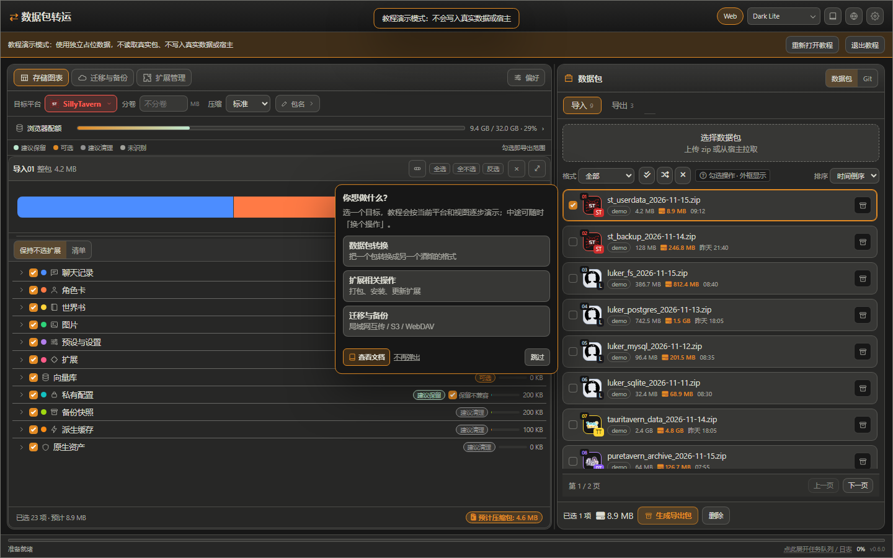
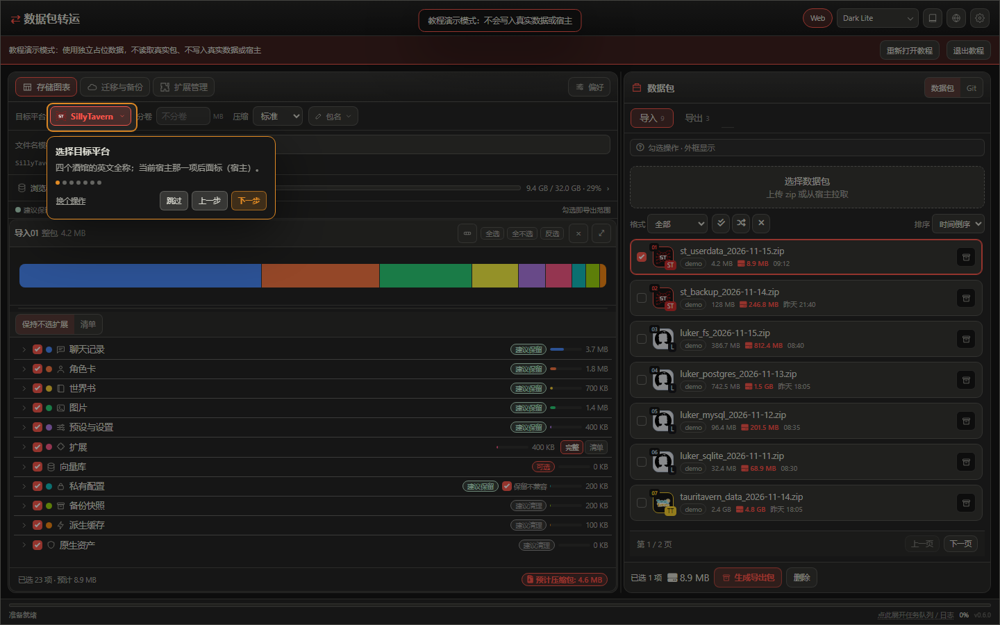

# 安装与部署

## 界面预览

初次安装打开后的教程引导，会带你在模拟数据上熟悉界面：

<figure class="shot-figure">
  
  <figcaption>教程目标选择：挑选想体验的演练功能</figcaption>
</figure>

<figure class="shot-figure">
  
  <figcaption>分步指引：系统逐步高亮当前操作</figcaption>
</figure>

## 一、先选运行形态

| 形态 | 怎么用 | 适合场景 | 宿主 / 浏览器要求 |
| --- | --- | --- | --- |
| 酒馆扩展 | 在酒馆扩展管理里从仓库 URL 安装 | 在酒馆内直接拉取、恢复、管理扩展 | 见下方“宿主版本” |
| 在线 Web | 直接打开在线地址 | 纯本地转换、分析、分卷 | 现代桌面或手机浏览器 |
| 单文件 HTML | 下载后双击 | 无网络、离线、随身携带 | 现代桌面浏览器；`file://` 可运行 |
| 本地静态服务 | 构建后通过 HTTP 打开 | 自建站点、局域网共享 | 任意现代浏览器 |

### 单文件 HTML 的确切下载路径

- 从 GitHub Release 下载：<https://github.com/jiozhaoyue/ST-pack-transfer/releases/latest/download/ST-pack-transfer-offline.html>
- 在线 HTML：<https://jiozhaoyue.github.io/ST-pack-transfer/>

> 根目录的 `index.html` 是开发骨架，**不能单独下载后双击使用**；它依赖开发服务器或构建后的静态服务。想要双击即用，请下载上面的单文件 HTML。

### 三形态逐步操作对照

下面按「怎么打开 → 能看到什么 → 常见用途」对照三种常用形态。
核心转换逻辑三形态一致；差异集中在宿主相关功能。

| 形态 | 第一步怎么打开 | 界面入口 | 宿主功能 | 适合做什么 |
| --- | --- | --- | --- | --- |
| 酒馆扩展 | 酒馆「扩展管理 → 从 URL 安装」→ 刷新 → 扩展列表展开「数据包转运」→「打开面板」 | 全屏工作台模态，含设置 / 日志 / 帮助视图 | 完整：从宿主拉取、写回宿主、扩展管理、服务端存储审查 | 日常备份、恢复、管理扩展 |
| 独立 Web | 打开 <https://jiozhaoyue.github.io/ST-pack-transfer/> | 页面直接呈现工作台 | 无宿主后端，拉取 / 恢复 / 服务端管理禁用 | 纯本地转换、分析、分卷、扫码互传 |
| 单文件 HTML | 从 GitHub Release 下载 `ST-pack-transfer-offline.html` → 双击 | 与 Web 版相同的工作台，`file://` 下运行 | 同 Web 版，无宿主功能 | 无网络、离线、随身携带 |

逐步说明：

1. **酒馆扩展**：粘贴仓库 URL 安装后刷新页面，在扩展列表展开「数据包转运」，点「打开面板」进入工作台。首次打开会进入教程演示。
2. **独立 Web**：直接用浏览器打开在线地址，无需安装；工作台内的转换、分卷、体积分析、局域网互传均可使用。
3. **单文件 HTML**：下载上面的离线文件后双击，浏览器在 `file://` 协议下直接运行全部纯前端功能。

> 三形态都能使用问题报告、脱敏分发与本地脱敏门禁；宿主拉取与写回只在酒馆扩展形态可用。详见 [问题报告](issue-report.md) 与 [隐私与凭据](privacy.md)。

## 二、装进酒馆（推荐）

打开酒馆的「扩展管理」→「从 URL 安装」，粘贴仓库地址：

```
https://github.com/jiozhaoyue/ST-pack-transfer.git
```

也可以手动把仓库克隆到酒馆的扩展目录。刷新酒馆页面后，在扩展列表里展开 **「数据包转运」** 并点击 **「打开面板」**。

> Luker 的用户私有扩展放在 `data/<user>/extensions/<name>/`，直接放插件目录即可，不要再嵌套一层 `third-party`。

## 三、宿主版本与能力

| 宿主 | 已实测版本 | 最低要求 | 能力说明 |
| --- | --- | --- | --- |
| SillyTavern | 1.19.0 | 1.19.0 级别端点 | 支持拉取、恢复、扩展管理；更低版本未验证 |
| Luker | 2.7.0 / 2.9.0 级别 | 2.7.0 级别基础功能；2.9+ 账户窗口 | 2.9+ 才有自绘账户窗口、图形化存储页与备份选择 |
| TauriTavern | 当前公开桌面构建 | 按宿主公开版本 | 迁移端点按能力探测；不支持时明确提示 |
| PureTavern | 当前公开版本 | 按宿主公开版本 | 部分迁移端点在宿主侧可能返回 501，插件会如实提示 |
| 独立 Web | 不适用 | 现代浏览器 | 无宿主后端，宿主相关功能禁用 |

插件不猜测宿主版本，而是按公开端点做能力探测：能力存在就使用，不存在就明确降级，不假装成功。

## 四、浏览器与 WebView

| 内核 | 建议版本 | 已验证 | 降级行为 |
| --- | --- | --- | --- |
| Chromium（Chrome / Edge 等） | 120+ | Chromium 151 | 支持选位置保存与拖拽下载；旧内核回退普通下载 |
| Firefox | 120+ | 未单独实测 | 不支持 `showSaveFilePicker` / 拖拽下载时回退普通下载 |
| Safari / iOS WebView | 17+ | 未单独实测 | 不支持 `color-mix` 时使用 rgba 边框；文件保存回退下载 |
| Tauri WebView | 随宿主 | 按宿主 | Windows 使用 WebView2，macOS 使用 WKWebView |

移动端布局按 390×844 验收，桌面端按 1440×900 验收。手机浏览器与酒馆内置 WebView 使用同一套响应式规则。

### 分辨率行为对照

界面只有一条分界线：**宽度 860px**。窗口宽于 860px 是桌面布局，窄于或等于 860px 是手机布局。手机上转换与宿主功能照常可用，只是排布方式改变，不是功能被删掉。

| 场景 | 典型宽度 | 你看到的排布 |
| --- | --- | --- |
| 桌面 | 1440px | 左右分栏：左侧数据包列表以侧栏形式常驻，右侧展示图表、配额与操作区；页头控件单行排开 |
| 平板 / 临界 | 860px | 恰在分界线上，按手机布局呈现：数据包区不再用侧栏，改为「数据包 / Git」切页按钮；点按钮在列表与内容间切换 |
| 手机 | 390px | 与 860px 同属手机布局，纵向排布更紧凑：列表行收成两行，长名称省略；唯一滚动容器是主内容区，滑动页面只滚这一处 |

关于 860px 临界的两点说明：

- 这个宽度**算手机布局**，不是桌面布局。「等于 860」和「小于 860」行为一致，避免临界抖动。
- 判定用的是面板实际宽度，不是整个窗口宽度。在酒馆里把面板拉窄，即使屏幕很宽，也会按手机布局呈现。

触屏细节（手机与酒馆内置 WebView 通用）：

- 页头图标按钮与主题下拉高度统一为 32px，窄屏折行时不会把相邻按钮挤出屏幕。
- 在系统「鼠标指针」为触屏的设备上，折叠箭头不小于 24px、紧凑文字按钮不小于 28px，方便手指点按。
- 只有传输与扩展这类自带内滚的视图会在自身内部滚动，其余区域统一由主内容区滚动，不会出现多层滚动打架。

## 五、本地构建与预览

```bash
git clone https://github.com/jiozhaoyue/ST-pack-transfer.git
cd ST-pack-transfer
npm install
npm run dev        # 本地开发服务器，终端会打印实际地址
npm run build      # 生产构建，输出 dist/
npm run preview    # 预览 dist/，终端会打印实际地址
npm run build:offline  # 生成单文件 HTML
```

- `npm run dev` 与 `npm run preview` 的地址以终端输出为准。
- 直接双击根目录 `index.html` 会被浏览器的模块安全策略拦截，这是 `file://` 的正常限制；需要双击运行时请用单文件 HTML。

## 六、在线使用（Web 模式）

无需安装，直接打开：<https://jiozhaoyue.github.io/ST-pack-transfer/>

想搭建自己的站点：Fork 本仓库，在 **Settings → Pages** 中把 Source 设为 **GitHub Actions**。

### Web 模式限制

- 不能直接「从宿主拉取」或「写回宿主」，因为 Web 模式没有酒馆后端。
- 不能读取宿主服务器磁盘，也不能管理服务端插件。
- 所有纯本地转换、分卷、清单化、体积分析功能完整可用。
- 云端 S3 / WebDAV 需要目标服务端正确配置 CORS；代理扩展只能转发流量，不能绕过浏览器 CORS。

## 七、安装后建议

1. 首次打开会进入 [教程演示模式](tutorial.md)，在模拟数据上熟悉界面。
2. 需要备份当前酒馆时，按 [从宿主拉取](host-pull.md) 操作。
3. 安装私有仓库扩展前，先读 [隐私与凭据](privacy.md)。
