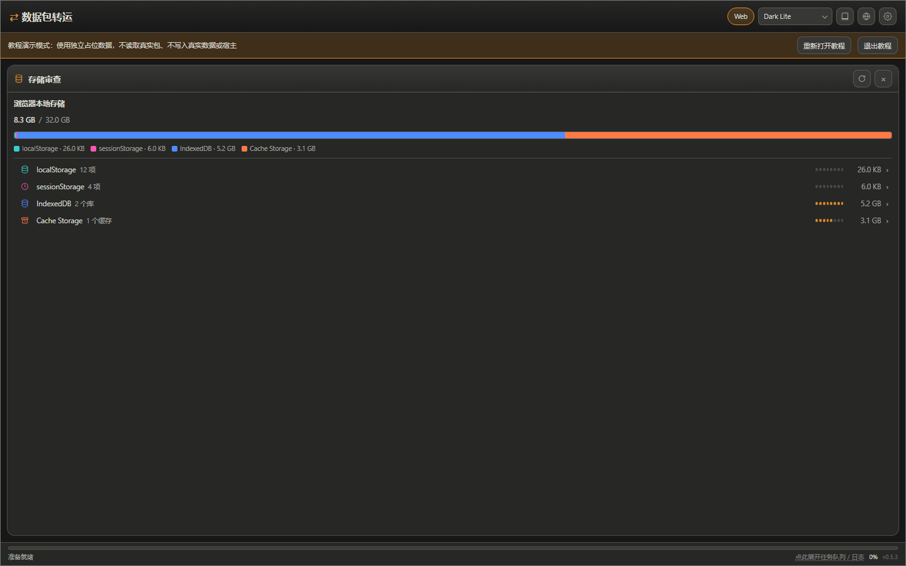
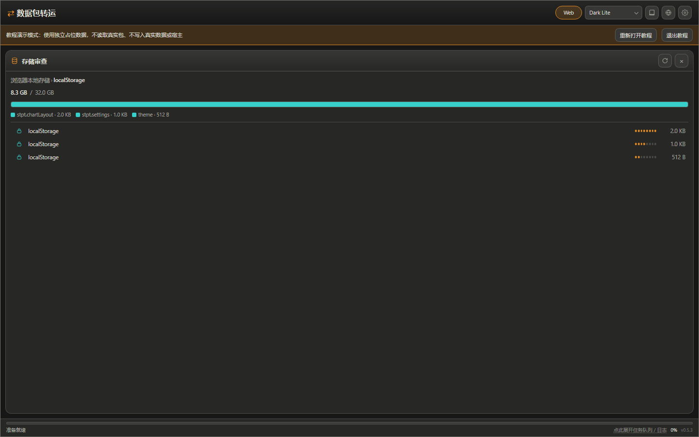

# Storage inspector

See how much space the current browser's local storage and the tavern server use. The inspector is read-only and focuses on a clear view of the distribution.

## Where to find it

The workbench header shows two storage quotas: **Browser** and **Host**. Click either row to open the inspector; the panel can also switch between sources.

<figure class="shot-figure">
  
  <figcaption>Inspector: quota bar, share legend, and detail list on one screen</figcaption>
</figure>

<figure class="shot-figure">
  
  <figcaption>localStorage: usage by key</figcaption>
</figure>

## What you can inspect

Use the breadcrumb navigation to drill down:

- **Web local storage** (localStorage / sessionStorage): size of individual settings or cache keys.
- **Browser databases** (IndexedDB): usage by database and object store.
- **Static asset caches** (Cache Storage): size by cache category.
- The quota is shown as **used / total** in the panel header only; it is no longer duplicated as a category that could be confused with IndexedDB. The progress bar, share legend, and detail list appear together.

## Reading the data

- Items whose exact size cannot be read because of browser security restrictions show a question mark (`?`) or "not provided", honestly reflecting what was actually read: when a value cannot be read it is labeled as such — never a fabricated 0 or an invented number.
- If the current tavern natively supports storage inspection (for example Luker), the plugin connects to the native data source for server-side usage; other taverns show their current support level.
- All readings reflect the current environment in real time.

## Cleaning up space

The inspector is for analysis. To free space:

- Select unneeded packages in the **Package list** on the right and delete them;
- Or uninstall unused extensions, or pack them as manifest-only entries (Full + Manifest is also possible) in **Extension management & packing**; see [Extension management & packing](extensions.en.md).
