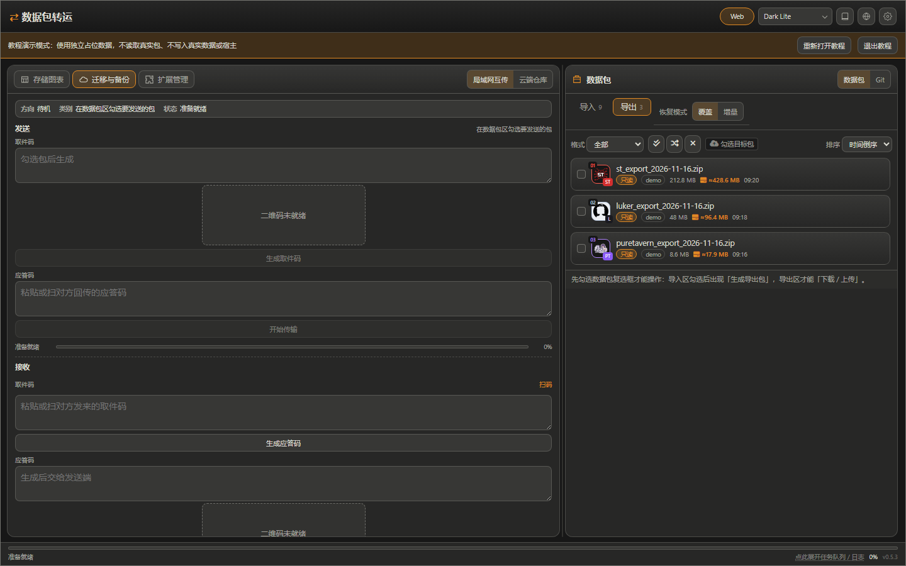
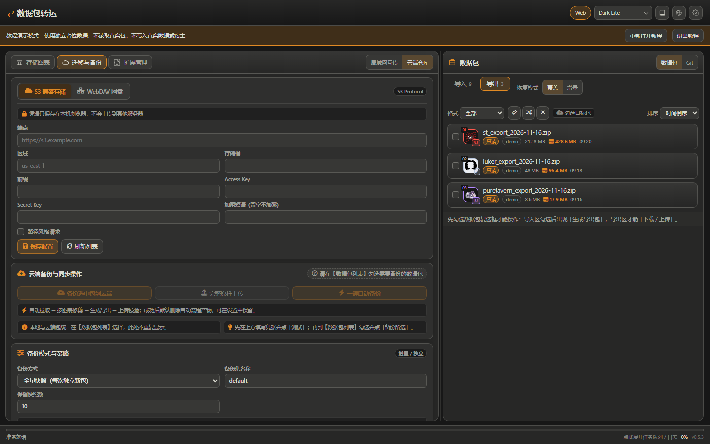
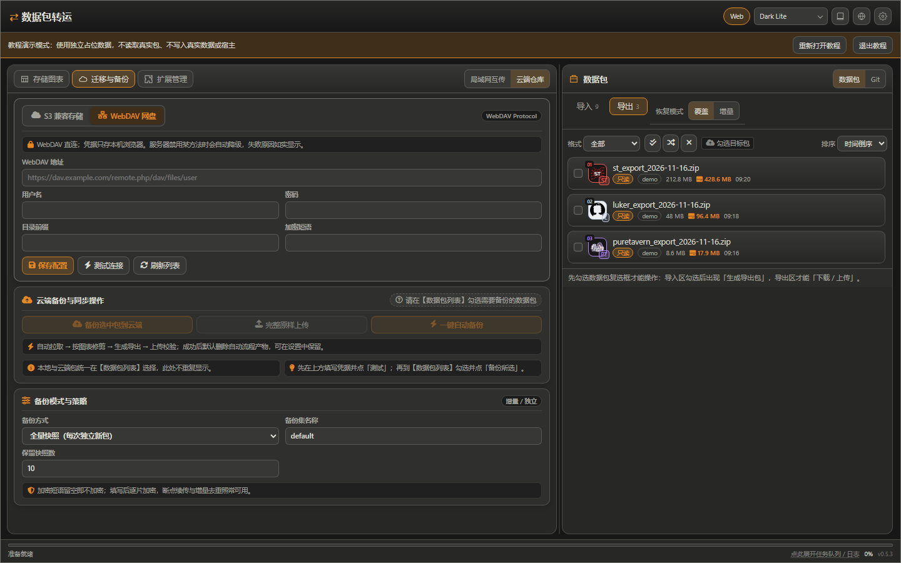
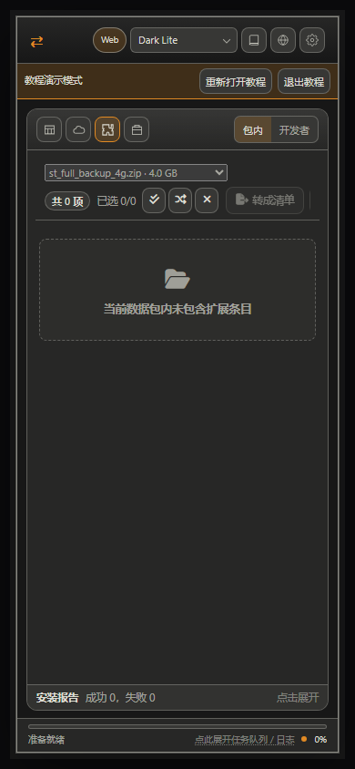

# Transfer & backup

Open **Migration & backup** from the view switch at the top of the panel. Select the packages you want to transfer or back up in the package list on the left.

<figure class="shot-figure">
  
  <figcaption>LAN transfer: scan a code for a peer-to-peer link</figcaption>
</figure>

<figure class="shot-figure">
  
  <figcaption>Cloud backup: S3-compatible object storage</figcaption>
</figure>

<figure class="shot-figure">
  
  <figcaption>WebDAV backup: cloud drives and private NAS</figcaption>
</figure>

<figure class="shot-figure">
  
  <figcaption>Mobile migration and backup entry</figcaption>
</figure>

## Direct LAN transfer

- **Scan and connect**: if the phone and computer are on the same Wi-Fi/LAN, scanning the QR code establishes a direct peer-to-peer connection. Scanning opens a full-screen viewfinder: the framing box tells you whether the code is aligned, and a successful scan connects automatically.
- **Private and fast**: data travels directly between the two devices without an external server. Browsers cannot actively scan for nearby devices; connection info is exchanged once via QR code or copy-and-paste.
- **Resume support**: large packages are transferred in chunks and resume automatically after network hiccups.
- **Secure-context requirement**: the peer-to-peer link relies on browser WebRTC, available only in a **secure context** (`https` or the machine's loopback address). Opening the tavern via `http://<LAN-IP>` is not a secure context, so the browser rejects the direct connection; `probeDirectCapability` in `src/core/lan-transfer.js` reports it honestly. Use https or the loopback address on the host machine instead.
- **Integrity-check limit**: the transfer digest is a whole-file SHA-256, but a single file over **512 MB** cannot be digested by the browser; it falls back to a byte-level check and the UI honestly marks "digest not checked" (`DIGEST_MAX_BYTES`, `src/core/lan-transfer.js`).

## Cloud backup: S3-compatible object storage

Back up packages directly to S3-compatible storage such as Alibaba Cloud OSS, Tencent Cloud COS, Cloudflare R2, or MinIO:

- **Clear configuration**: endpoint, region, bucket, path prefix, and access key / secret key.
- **Reliable transfer**: automatic chunked upload with resume.
- **Encryption**: if a backup password is set, chunks are encrypted locally before upload, so the cloud cannot read the plaintext.
- **Direct connection**: standard S3 request signing; the plugin talks to the object storage endpoint directly by default.

## Cloud and NAS backup: WebDAV

Back up packages to WebDAV drives or private NAS devices such as Synology, QNAP, Jianguoyun, or Alist:

- **Basic configuration**: WebDAV server URL, username, password, and target directory.
- **Large files**: chunked upload, resume, and password encryption.
- **Connection test**: **Test connection** verifies directory access, write, and read permissions and reports each result in the UI.

## One-click backup modes

Two backup strategies are available:

- **Full snapshot**: each backup creates an independent timestamped version; keep the latest N versions.
- **Incremental backup**: only new or changed content is synced, saving cloud space; each version can still be restored independently and completely.

## Credential safety

The cloud configuration page includes a help panel with the minimum permissions required by each service. S3 and WebDAV credentials are stored **only in the current browser's local storage (LocalStorage)** by default and are not written into the tavern configuration. See [Privacy & credentials](privacy.en.md).

## Network proxy

If Git or WebDAV access is slow on a particular network, set a dedicated CORS proxy in **Settings → Network**. Leave it empty to connect directly.
