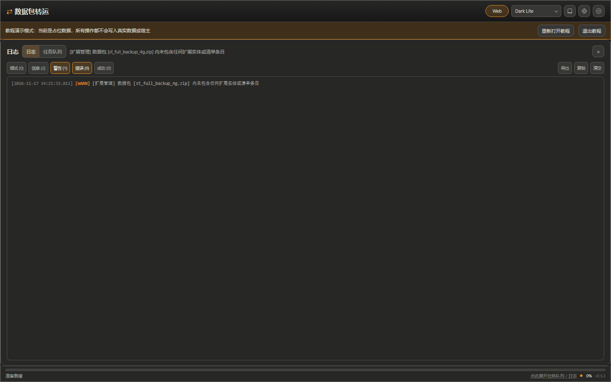
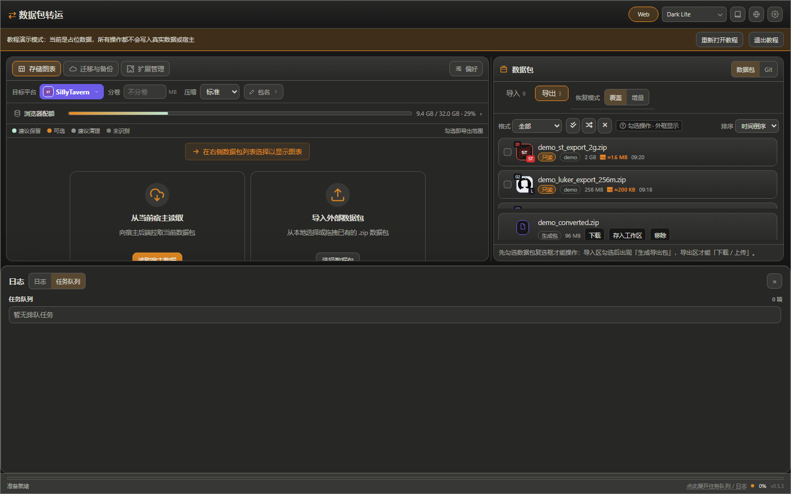
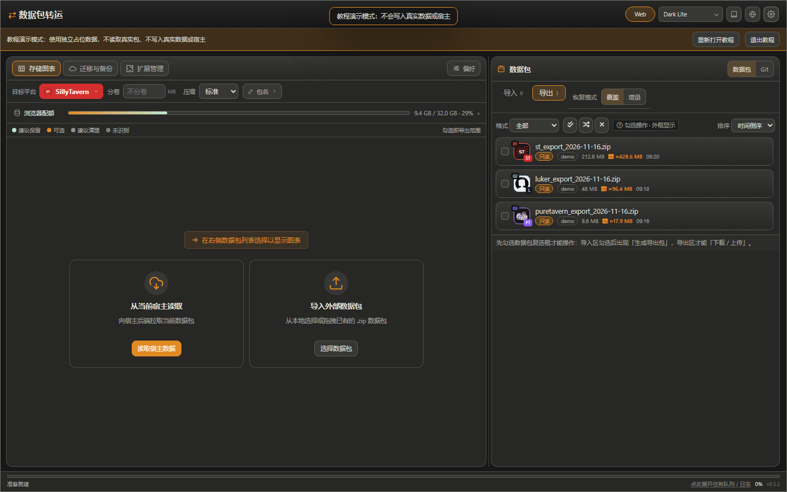
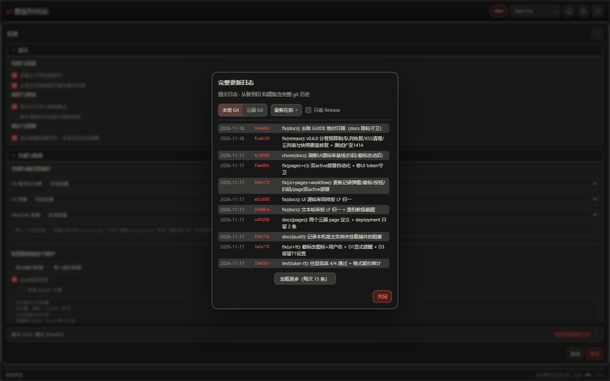
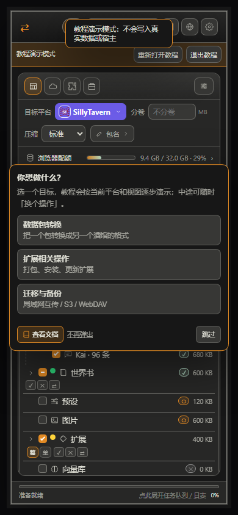
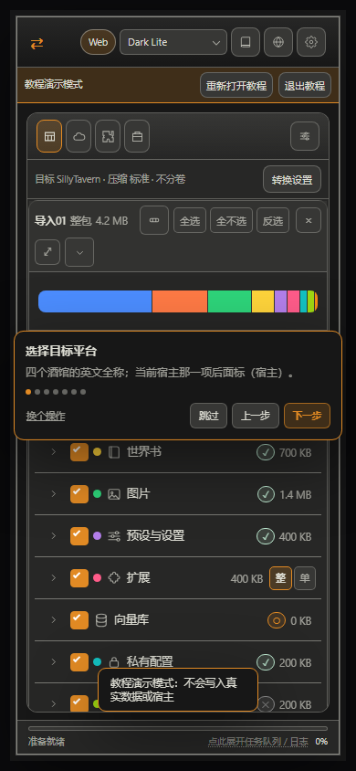
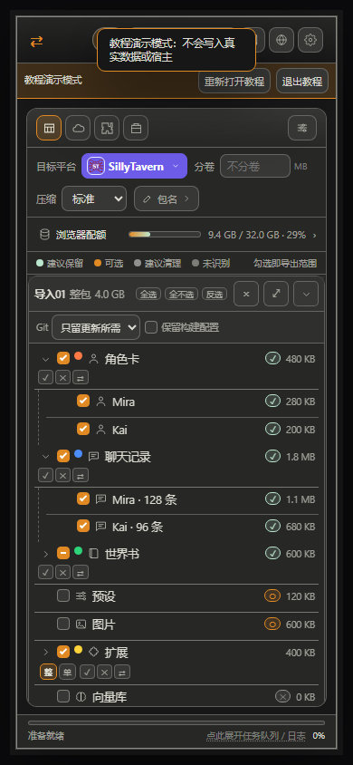
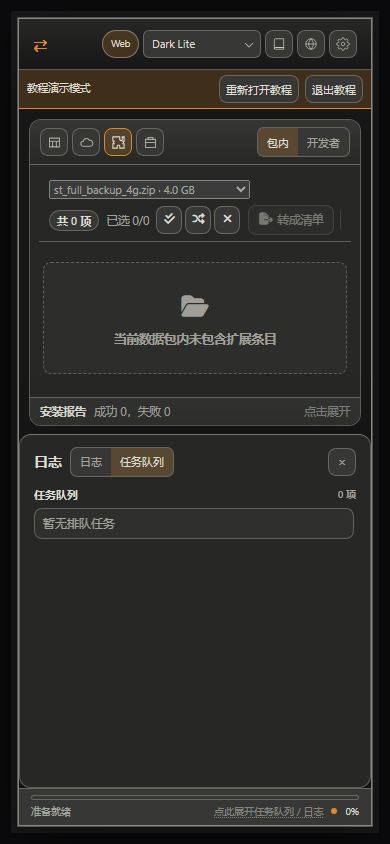
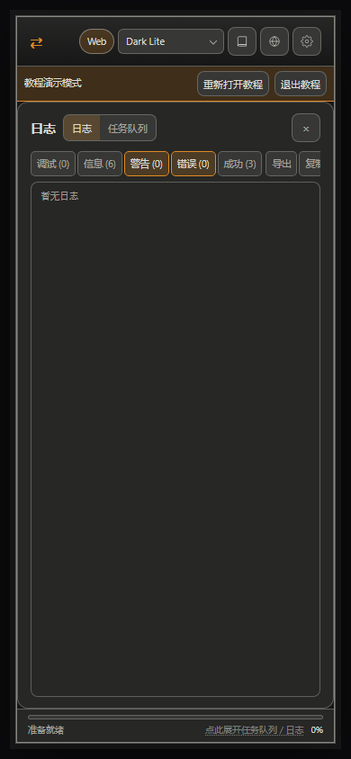

# 教程演示模式

内置沙盒式演练环境，带你在模拟示例数据上完整体验各项转运与备份操作。体验过程完全在本地模拟，不会改动你的任何真实聊天与配置，退出后即刻完整还原真实界面。

## 界面预览

以下截图全部来自教程演示模式，展示真实界面与模拟数据（不含任何用户聊天内容）。其余功能页（安装、转换、扩展、传输、存储）就近配有各自界面的截图，本页集中展示日志、队列、设置与手机端演示画面。

### 日志与任务队列

<figure class="shot-figure">
  
  <figcaption>桌面端日志视图</figcaption>
</figure>

<figure class="shot-figure">
  
  <figcaption>桌面端任务队列（半展开）</figcaption>
</figure>

### 设置与更新日志

<figure class="shot-figure">
  
  <figcaption>设置面板</figcaption>
</figure>

<figure class="shot-figure">
  
  <figcaption>更新日志</figcaption>
</figure>

### 手机端（390×844）

<figure class="shot-figure">
  
  <figcaption>手机教程目标选择</figcaption>
</figure>

<figure class="shot-figure">
  
  <figcaption>手机教程分步指引</figcaption>
</figure>

<figure class="shot-figure">
  
  <figcaption>手机演示工作台</figcaption>
</figure>

<figure class="shot-figure">
  
  <figcaption>手机任务队列（半展开）</figcaption>
</figure>

<figure class="shot-figure">
  
  <figcaption>手机日志（全展开）</figcaption>
</figure>

## 如何开启

初次安装并打开面板时会自动进入演示模式。平时你也可以随时点击界面顶部的教程按钮重新开启体验。

## 支持演练的目标任务

进入教程后，你可以根据想了解的功能挑选演练目标：

- 数据包格式转换演练
- 恢复写回酒馆演练
- 从酒馆直接拉取演练
- 扩展管理与打包演练
- 局域网与云端备份演练

挑选好目标后，系统会一步一步高亮指引操作步骤；在体验过程中，你也可以随时点击「换个操作」体验其它功能。

## 手机端说明

教程浮层已固定在浏览器视口上（直接挂在 `document.body`，不受宿主抽屉滚动/缩放的坐标系影响），
并用动态视口高度铺满；卡片过高时在卡片内部滚动，按钮始终可点。若你从很长的数据包列表中间打开教程，
浮层也不会再停在页面顶部之外。

## 完整 / 清单怎么选（含网络环境建议）

教程里的扩展管理步骤会同时展示两个按钮，并给出智能建议：

- **本插件自身、无远端地址、私有仓库** → 建议**完整**；
- **公开 Git 远端** → 建议**清单**；
- **网络环境差、被 GFW 封锁、或目标机器访问不了 GitHub/GitLab** → 即使建议清单，也请手动改选**完整**并带走实体；
  否则目标宿主无法在线拉取，扩展会装不上。

两个按钮可以同时点亮（双选）：既带实体，又保留清单，适合「先保证能用，之后再在线更新」的场景。

## 演示环境特色

- **放心操作**：你可以自由勾选数据包、体验生成流程、模拟删除或打开存储审查；
- **贴心引导**：涉及外部网络请求或系统写入的操作均由模拟数据承接，并配有贴心的说明提示，完全保护真实环境；
- **场景丰富**：模拟数据预先准备了四款酒馆、不同体积大小的典型数据包，还原真实使用感受；体积范围按演示包清单自动插值生成（当前约 4.2 MB 到 2.4 GB），不写死固定值。

## 如何退出演示

你可以随时通过以下方式退出教程并回到真实工作区：

- 点击顶部常驻的「退出教程」开关；
- 或者点击上方横幅右侧的「退出教程」按钮。

如果点击了「跳过引导」，界面会隐藏引导浮层但保留演示数据，方便你自由随意点击探索；需要恢复引导时，点击横幅上的「重新打开教程」即可继续。走完所有演练步骤后，你可以从容决定何时退出回到真实工作区。
